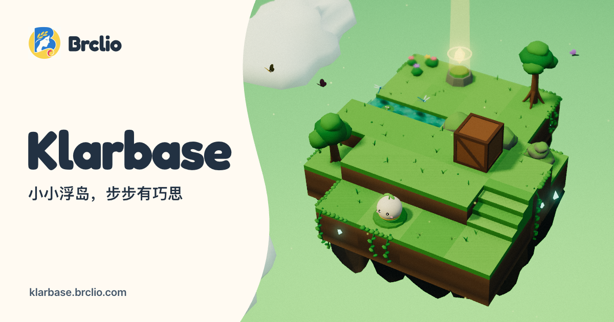
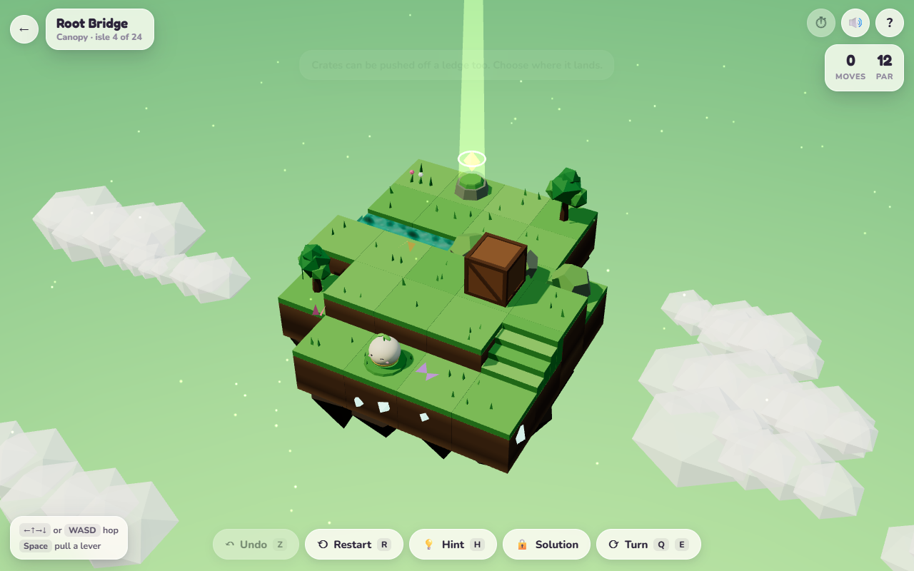
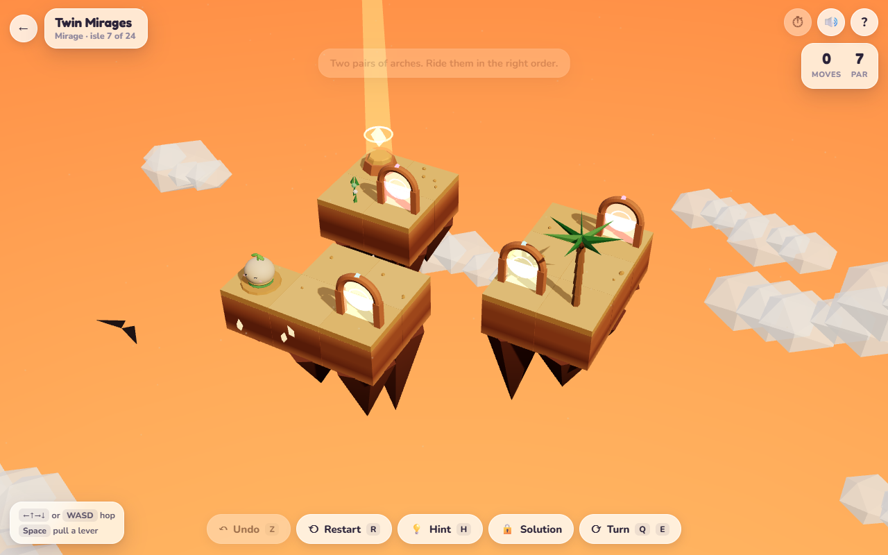
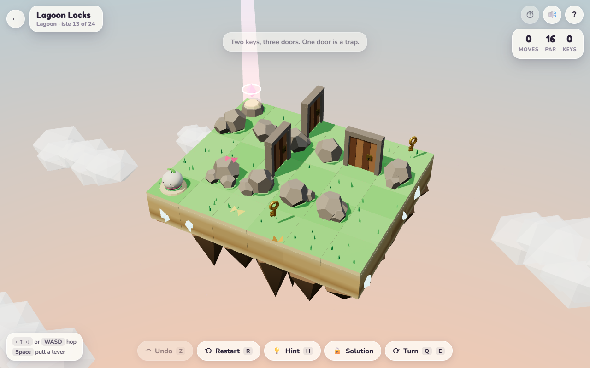
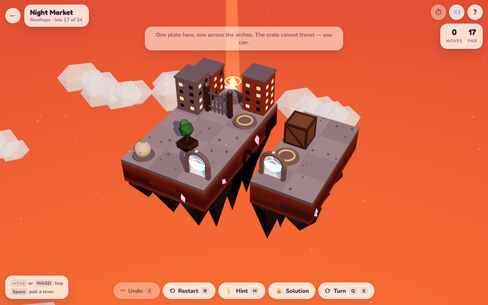
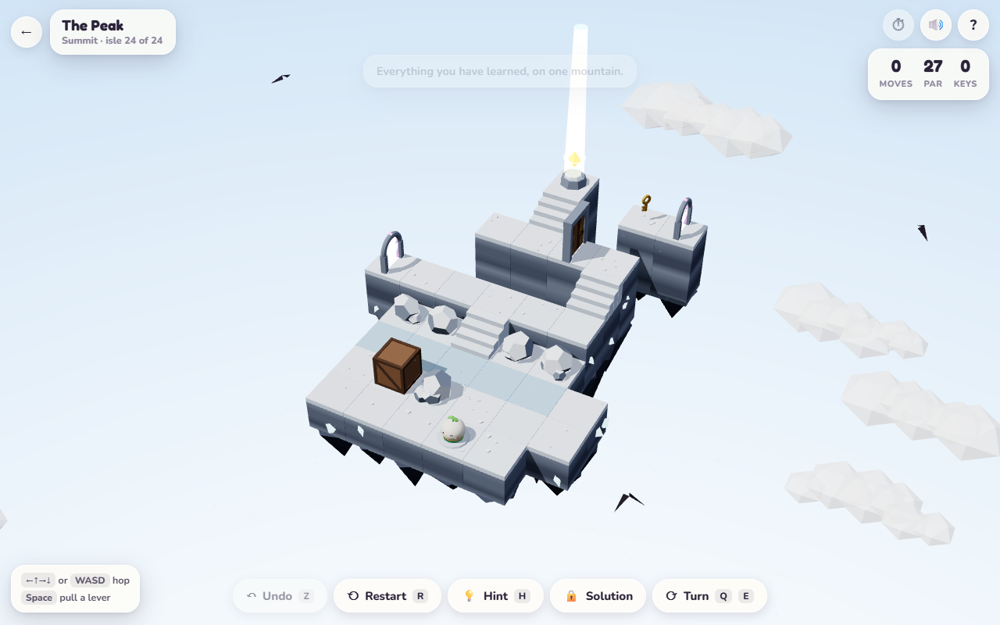
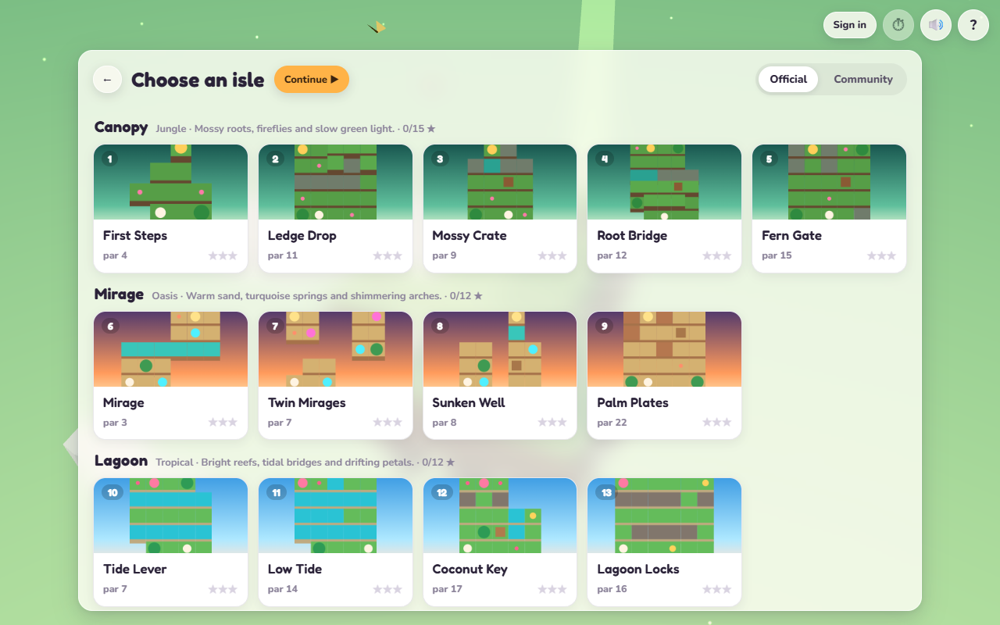
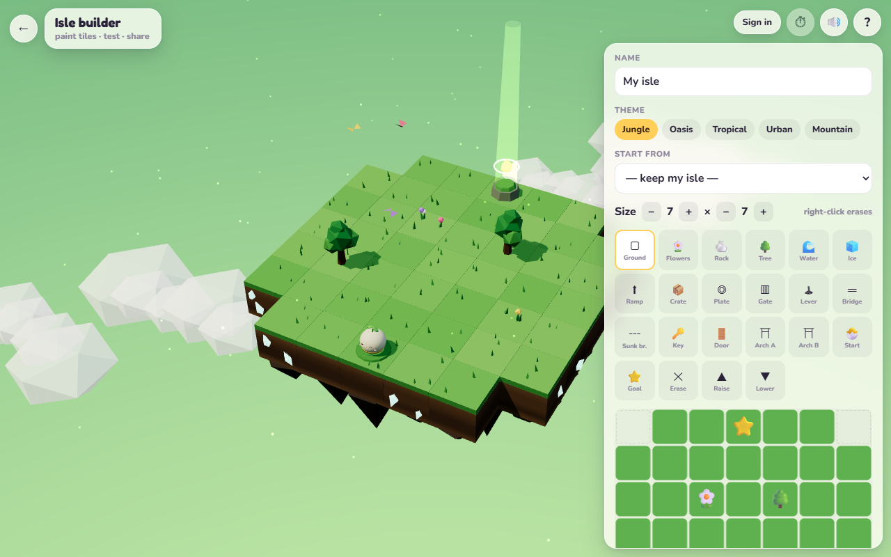

<div align="center">

# Brclio Klarbase 🏝️

黄家宝（AI悦创）维护的浮岛解谜游戏。默认简体中文，可随时切换英语。

[开始游戏](https://klarbase.brclio.com) · [Brclio 品牌站](https://brclio.com) · [AI悦创个人站](https://bornforthis.cn)

[](https://github.com/Brclio/Brclio-klarbase/actions/workflows/ci.yml)
[](LICENSE)
[](https://github.com/Brclio/Brclio-klarbase/stargazers)
[](https://github.com/Brclio/Brclio-klarbase/issues)
[](https://klarbase.brclio.com)

[**▶ Play at klarbase.brclio.com**](https://klarbase.brclio.com) · [Make an isle](#make-an-isle) · [Contribute](CONTRIBUTING.md) · MIT licensed



</div>

<table>
  <tr>
    <td width="50%"><br><sub><b>Canopy</b> · jungle — push the crate into the spring, climb the stairs</sub></td>
    <td width="50%"><br><sub><b>Mirage</b> · oasis — ride the arches in the right order</sub></td>
  </tr>
  <tr>
    <td width="50%"><br><sub><b>Lagoon</b> · tropical — two keys, three doors, one trap</sub></td>
    <td width="50%"><br><sub><b>Rooftops</b> · urban — plates, gates and a crate that can't travel</sub></td>
  </tr>
  <tr>
    <td width="50%"><br><sub><b>Summit</b> · mountain — everything you've learned, on one peak</sub></td>
    <td width="50%"><br><sub>Hand-made isles, each with a par and up to three stars</sub></td>
  </tr>
</table>

A cozy browser puzzle game. Guide **Pip**, a round little sprout spirit, across floating
dioramas — push crates into the water to make bridges, slide across ice, pull levers that flip
bridges, step through arches — one hop per key, to the glowing star.

- **56 official isles in nine chapters**, including Sky Scales in Hanging Gardens, balloons in Windward and moving hazards in Nightfall. The **Daily Isle** (`/daily`) gives everyone the same puzzle and a spoiler-free result to share.
- **Every isle shows its difficulty** on a 0–100 scale from Breeze to Mythic. The Brclio edition uses the maker’s rating or the solver’s estimate.
- **Every isle is solver-verified** — solvable, with an exact par and a replayable smart
  solution (earn it by signing in, clearing the isle, or putting in the time).
- **Build your own** in the in-game builder, share it online, or **contribute it here by pull
  request** — automated checks make sure it's solvable and fair, and you're credited by name.

This edition runs on Cloudflare Free. The game opens in Simplified Chinese and can be switched to English at any time. Play and build as a guest, or register with an email address, password and public display name to sync progress, share isles and post comments. GitHub sign-in is also available. Return with the same sign-in method to load your save. [Play](https://klarbase.brclio.com) · [Privacy](https://klarbase.brclio.com/privacy) · [Deployment](DEPLOYMENT.md)

## Make an isle

```text
-  ,1 G1 -  -  -          an isle is just text: one tile per token,
-  .1 ^  -  -  -          row 0 is north, digits are heights
.  .  .  ~  C  .
~  ~  ~  ~  .  .
S  ,  p  -  .  p
```



Build it in the game (**Create**) and press **Propose on GitHub** — GitHub opens a prefilled PR that adds
`isles/community/<your-username>/<id>.json`. Full guide: **[CONTRIBUTING.md](CONTRIBUTING.md)** ·
tile reference and rules: **[isles/README.md](isles/README.md)**.

## Run it locally

Use Node.js 22 to match the production build.

```bash
npm install
npm run dev:client          # the game at http://localhost:5173 — play and build, no server needed
npm test                    # engine + all official isles + contribution rules
node tools/check-isles.mjs  # the same check every isle PR runs
```

For the Cloudflare build, run `npm run build:pages`. It checks the Pages API and puzzle verifier before generating `client/dist`. Sign-in and online sharing use Pages Functions and per-record GitHub storage. [Deployment settings](DEPLOYMENT.md)

## Where things live

| Folder | What's in it |
| --- | --- |
| [`core/`](core) | `@klar/core` — the rules, the solver, the official isles and the contribution rules (pure JS, zero deps) |
| [`client/`](client) | `@klar/client` — the game and builder: Vite + three.js, all art and audio procedural |
| [`functions/`](functions) | Cloudflare Pages API for email and GitHub sign-in, cloud saves, online isles and comments |
| [`cloudflare/`](cloudflare) | Internal Worker and Durable Object for server-side isle verification |
| [`server/`](server) | Shared validation, server tests and the optional Express/PostgreSQL backend |
| [`isles/`](isles) | the isles as JSON: `official/`, `community/<author>/` and `daily/`, plus the format guide |
| [`tools/`](tools) | `check-isles.mjs` (the PR gate), `author.mjs` (official isle artifacts), difficulty audit |
| [`docs/`](docs) | screenshots, the game summary and design proposals |

The rules live in exactly one place (`core/src/isle/`). The game, the builder, the solver, the
PR checks and the server all use it, so they can never disagree. Engineering notes:
[ENGINEERING.md](ENGINEERING.md).

## Community

- **[Brclio issues](https://github.com/Brclio/Brclio-klarbase/issues/new/choose)** — bugs, isle ideas, feature requests
- **Questions or private feedback** can go to the maintainer, 黄家宝 (AI悦创, [@AndersonHJB](https://github.com/AndersonHJB)). [Email](mailto:bornforthis@bornforthis.cn)
- **[Code of Conduct](CODE_OF_CONDUCT.md)** · [Community guidelines](https://klarbase.brclio.com/guidelines) · [Privacy](https://klarbase.brclio.com/privacy)

## Contributors

Brclio maintains this edition. The original Klarbase game is by TanmoyP and the Klarbase contributors. Each community isle keeps its own author credit. [Brclio repository contributors](https://github.com/Brclio/Brclio-klarbase/graphs/contributors) · [Original MIT notice](LICENSE)

## License

[MIT](LICENSE) — code and isles alike. Isles you contribute are released under the same
license, and the game always shows who made them. Security reports: [SECURITY.md](SECURITY.md).

The Brclio mark used in the site icons and sharing image comes from the Brclio brand kit. Its visual direction is based on the Esther Design System, © 2026 ESTHER不二 (esthersjw), under CC BY-NC-SA 4.0. The sharing image combines the mark with the game scenery. [Brand and third-party credits](https://klarbase.brclio.com/licenses) · [CC BY-NC-SA 4.0](https://creativecommons.org/licenses/by-nc-sa/4.0/)
